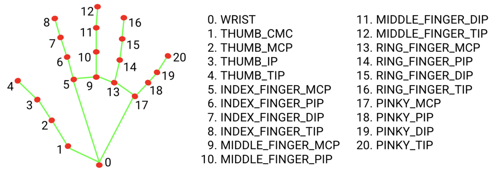

<div align="center">


**Hands-on artificial intelligence projects for students — computer vision, voice control, machine learning and chatbots.**

Every line of code is commented so you can read it like a lesson. 📖


</div>

---

## 📚 Table of contents

- [How the repo is organised](#-how-the-repo-is-organised)
- [01 · Starter — 15 tiny projects](#-01--starter--15-tiny-projects)
- [02 · Vision & Voice](#-02--vision--voice)
- [03 · Machine Learning](#-03--machine-learning)
- [04 · CampusBot](#-04--campusbot)
- [Installation](#%EF%B8%8F-installation)
- [Folder structure](#-folder-structure)
- [Troubleshooting](#-troubleshooting)
- [Challenges for students](#-challenges-for-students)

---

## 🗺 How the repo is organised

The folders are numbered in the order we recommend. Start at **01** and climb!

| Folder | Level | What's inside | Python environment |
|---|:-:|---|---|
| [`01_Starter/`](01_Starter) | ⭐ | **15 tiny projects** (5 – 25 lines): camera, voice, text & ML | `mediapipe_env` |
| [`02_Vision_and_Voice/`](02_Vision_and_Voice) | ⭐⭐ | Control your computer with your **hands** and **voice** | `mediapipe_env` |
| [`03_Machine_Learning/`](03_Machine_Learning) | ⭐⭐ – ⭐⭐⭐ | scikit-learn, Teachable Machine, a neural network on IMDB | `ml_env` |
| [`04_CampusBot/`](04_CampusBot) | ⭐⭐⭐ | Your own ChatGPT-style assistant running locally | `04_CampusBot/.venv` |

```
 01 Starter  ──►  02 Vision & Voice  ──►  03 Machine Learning  ──►  04 CampusBot
 (5-25 lines)     (control the PC)        (train models)            (LLM chatbot)
```

---

## 🌱 01 · Starter — 15 tiny projects

Very short programs, each teaching **one** idea. Perfect for a first AI lesson.

### 📷 1_Camera

| # | Project | What it does | Lines |
|:-:|---|---|:-:|
| 01 | [`01_face_detector.py`](01_Starter/1_Camera/01_face_detector.py) | Draws a box around every face (no training needed!) | ~10 |
| 02 | [`02_finger_counter.py`](01_Starter/1_Camera/02_finger_counter.py) | Shows how many fingers you hold up (0 – 5) | ~20 |
| 03 | [`03_rock_paper_scissors.py`](01_Starter/1_Camera/03_rock_paper_scissors.py) | Play against the computer with your hand ✊✌️✋ | ~25 |
| 04 | [`04_air_drawing.py`](01_Starter/1_Camera/04_air_drawing.py) | Your index finger becomes a pen | ~25 |
| 05 | [`05_smile_camera.py`](01_Starter/1_Camera/05_smile_camera.py) | Takes a photo automatically when you smile 😀 | ~20 |

### 🎙 2_Voice

| # | Project | What it does | Lines |
|:-:|---|---|:-:|
| 06 | [`06_talking_computer.py`](01_Starter/2_Voice/06_talking_computer.py) | Type a sentence, the computer reads it out loud | ~5 |
| 07 | [`07_dictation.py`](01_Starter/2_Voice/07_dictation.py) | Speak and your words are saved into `notes.txt` | ~15 |
| 08 | [`08_voice_assistant.py`](01_Starter/2_Voice/08_voice_assistant.py) | A mini "Siri": time, date, jokes, opens YouTube | ~25 |
| 09 | [`09_pronunciation_game.py`](01_Starter/2_Voice/09_pronunciation_game.py) | Say English words — does Google understand you? | ~15 |

### 📝 3_Text_and_ML

| # | Project | What it does | Lines |
|:-:|---|---|:-:|
| 10 | [`10_spam_detector.py`](01_Starter/3_Text_and_ML/10_spam_detector.py) | Learns from 10 messages, then spots spam 🚫 | ~10 |
| 11 | [`11_mood_detector.py`](01_Starter/3_Text_and_ML/11_mood_detector.py) | Is your sentence happy 😀 or sad 😢? (+ how sure) | ~10 |
| 12 | [`12_grade_predictor.py`](01_Starter/3_Text_and_ML/12_grade_predictor.py) | Hours of study → predicted grade, with a chart | ~10 |
| 13 | [`13_handwritten_digits.py`](01_Starter/3_Text_and_ML/13_handwritten_digits.py) | Recognises handwritten digits 0 – 9 (≈ 97 %) | ~10 |
| 14 | [`14_rule_chatbot.py`](01_Starter/3_Text_and_ML/14_rule_chatbot.py) | A chatbot made only of `if` rules — see its limits | ~15 |
| 15 | [`15_quiz_maker.py`](01_Starter/3_Text_and_ML/15_quiz_maker.py) | A local AI writes 3 quiz questions from any text | ~6 |

> 💡 **Suggested order:** 06 → 01 → 10 → 02 → 08 → 03. Each one adds a single new idea, and rock-paper-scissors is a fun finale!
>
> 🔒 Photos from the smile camera and `notes.txt` from the dictation stay on your computer — they are never uploaded to GitHub.

---

## ✋ 02 · Vision & Voice

| Project | Topic | What it does | Level |
|---|---|---|:-:|
| [`CapturePhoto.py`](02_Vision_and_Voice/CapturePhoto.py) | 📷 Webcam | Takes a photo and saves it on your Desktop | ⭐ |
| [`SpeechRecognition.py`](02_Vision_and_Voice/SpeechRecognition.py) | 🎙 Voice | Clicks the mouse when you say a command | ⭐ |
| [`MediaPipeGeust.py`](02_Vision_and_Voice/MediaPipeGeust.py) | ✋ Hand tracking | Swipe your finger to change slides | ⭐⭐ |
| [`ControlPPTGesture.py`](02_Vision_and_Voice/ControlPPTGesture.py) | ✋ Gestures | Thumb up / down & finger positions control a presentation | ⭐⭐ |
| [`PPTcontrolGeustSpeech.py`](02_Vision_and_Voice/PPTcontrolGeustSpeech.py) | ✋ + 🎙 | Finger moves the mouse, voice clicks | ⭐⭐⭐ |
| [`MediaPipeSpeechUI.py`](02_Vision_and_Voice/MediaPipeSpeechUI.py) | ✋ + 🎙 + 🖥 | Same, inside a desktop app (Tkinter) | ⭐⭐⭐ |

<details>
<summary><b>🎙 Voice commands (French)</b></summary>

Used by `SpeechRecognition.py`, `PPTcontrolGeustSpeech.py` and `MediaPipeSpeechUI.py`. Needs an internet connection (Google speech-to-text).

| Say | Action |
|---|---|
| `clic gauche` | Left click |
| `clic droit` | Right click |
| `double clic` | Double click |
| `arrêt` | Stop (or type `q` + Enter in the terminal / press `q` in the app window) |

</details>

<details>
<summary><b>✋ Gestures of ControlPPTGesture.py + the 21 hand points</b></summary>

| Gesture | Key | Action |
|---|---|---|
| Index finger left of thumb | → | Next slide |
| Index finger right of thumb | ← | Previous slide |
| 👍 Thumb up | F5 | Start slideshow |
| 👎 Thumb down | Esc | Exit slideshow |

A 1-second pause after each key press stops one gesture from pressing the key 30 times.

The 21 hand landmarks found by MediaPipe (used by all hand projects, including the finger counter):

<p align="center"></p>
<p align="center"><sub>Image: <a href="https://ai.google.dev/edge/mediapipe/solutions/vision/hand_landmarker">Google MediaPipe documentation</a>, licensed <a href="https://creativecommons.org/licenses/by/4.0/">CC BY 4.0</a>.</sub></p>

</details>

<details>
<summary><b>🖥 What each project teaches</b></summary>

- **CapturePhoto** — `cv2.VideoCapture`, `cap.read()`, `cv2.imshow`, `cv2.imwrite`.
- **SpeechRecognition** — speech-to-text, threads, `try / except`.
- **MediaPipeGeust** — hand landmarks, coordinates between 0 and 1, measuring movement between frames.
- **ControlPPTGesture** — comparing landmark positions to recognise a gesture.
- **PPTcontrolGeustSpeech** — combining two AIs in parallel, smoothing a shaky signal.
- **MediaPipeSpeechUI** — a Tkinter window, `root.after()` for a video loop that doesn't freeze.

</details>

---

## 🧠 03 · Machine Learning

| Project | Topic | What it does | Level |
|---|---|---|:-:|
| [`tp1_sklearn.py`](03_Machine_Learning/tp1_sklearn.py) | 🌸 Classic ML | Random Forest classifies iris flowers (+ 7 other models to try) | ⭐ |
| [`TeachableKerasWebcam.py`](03_Machine_Learning/TeachableKerasWebcam.py) | 🧠 Deep learning | Recognises hand signs live with a Teachable Machine model | ⭐⭐ |
| [`IMDBmoviePrediction.py`](03_Machine_Learning/IMDBmoviePrediction.py) | 📊 Neural network | Predicts if you'll like a movie, trained on 9,826 IMDB movies | ⭐⭐⭐ |

<details>
<summary><b>🌸 tp1_sklearn.py — results and model comparison</b></summary>

Classifies **iris flowers** into 3 species (setosa, versicolor, virginica) from 4 measurements, using a **Random Forest** (100 decision trees that vote).

```
 150 flowers ─► 80% train / 20% test ─► RandomForest(100 trees) ─► report + confusion matrix
```

Expected result: about **90 % accuracy** on the 30 test flowers.

<p align="center"></p>

The diagonal holds the correct answers. All 3 mistakes are between *versicolor* and *virginica*, whose petals have similar sizes.

**Try other models:** the file contains 7 other models, ready to uncomment. Their F1 scores on the same test flowers:

<p align="center"></p>

⚠️ With only 30 test flowers, one mistake changes the F1 by about 0.03 — don't over-trust the ranking. Change `random_state` and see how it moves!

</details>

<details>
<summary><b>🧠 TeachableKerasWebcam.py — train your own model</b></summary>

Recognises 4 hand signs: `Handsok`, `HandRight`, `HandLeft`, `HandUp`.

**Train your own:** create an *Image Project* on [Teachable Machine](https://teachablemachine.withgoogle.com) → train → *Export model* → *TensorFlow* → *Keras* → replace `03_Machine_Learning/Model/keras_model.h5` and `labels.txt`.

</details>

<details>
<summary><b>📊 IMDBmoviePrediction.py — how it works</b></summary>

```
 CSV ─► clean data ─► train/test split ─► scale + one-hot encode ─► Dense(64) ─► Dense(32) ─► Dense(1, sigmoid) ─► 👍 / 👎
```

A movie counts as "liked" when its rating is above 7.

</details>

---

## 💬 04 · CampusBot

A chatbot for a school, running **100 % on your computer** with [Ollama](https://ollama.com) and Llama 3.2 (no API key needed). It answers in French.

| File | How to run | What it is |
|---|---|---|
| [`chat.py`](04_CampusBot/chat.py) | `python chat.py` | Chat in the terminal |
| [`app.py`](04_CampusBot/app.py) | `streamlit run app.py` | Chat web page with streaming answers |
| [`web/`](04_CampusBot/web) | `npm install && npm run dev` | Bonus: a full Next.js website with a chat widget |

**How a chatbot remembers:**

```
 messages = [ system prompt ]
      │
      ├─► user asks      → append {"role": "user", ...}
      ├─► send ALL messages to the model
      └─► model answers  → append {"role": "assistant", ...}   ↺ repeat
```

> 💡 Compare it with [`14_rule_chatbot.py`](01_Starter/3_Text_and_ML/14_rule_chatbot.py): same goal, no AI — what can't it do?

---

## ⚙️ Installation

### 1. Get the code

```bash
git clone https://github.com/Venki-Sub/AI-Python-Projects.git
cd AI-Python-Projects
```

### 2. Create the Python environments

MediaPipe and TensorFlow sometimes disagree on library versions, so we use **separate environments**.

**🌱 01 Starter + ✋ 02 Vision & Voice**

```bash
python3 -m venv mediapipe_env
source mediapipe_env/bin/activate        # Windows: mediapipe_env\Scripts\activate
brew install portaudio                   # macOS only: needed by PyAudio (microphone)
pip install -r requirements-vision.txt
```

**🧠 03 Machine Learning**

```bash
python3 -m venv ml_env
source ml_env/bin/activate               # Windows: ml_env\Scripts\activate
pip install -r requirements-ml.txt
```

**💬 04 CampusBot** and **project 15** (quiz maker)

```bash
# Install Ollama from https://ollama.com, then download the model:
ollama pull llama3.2:3b

cd 04_CampusBot                          # only for CampusBot
python3 -m venv .venv
source .venv/bin/activate
pip install -r requirements.txt
```

### 3. Run a project

```bash
source mediapipe_env/bin/activate
python 01_Starter/1_Camera/01_face_detector.py
```

> 💡 In VS Code: `Cmd+Shift+P` → **Python: Select Interpreter** → pick the environment from the table above.

### 4. Quit a project — always `q`

| Project type | How to quit |
|---|---|
| 📷 Camera window (OpenCV / Tkinter) | Click the video window, then press `q` |
| 🎙 Voice / no window | Type `q` then **Enter** in the terminal (a terminal only sends keys after Enter) — or say the stop word |
| 📝 Text in the terminal | Type `q` (or an empty line) then **Enter** |

> 🆘 If anything gets stuck: `Ctrl+C` in the terminal always stops the program.

---

## 📁 Folder structure

```
AI-Python-Projects/
├── 01_Starter/
│   ├── 1_Camera/              01 face detector · 02 finger counter · 03 rock-paper-scissors
│   │                          04 air drawing · 05 smile camera
│   ├── 2_Voice/               06 talking computer · 07 dictation · 08 voice assistant
│   │                          09 pronunciation game
│   └── 3_Text_and_ML/         10 spam · 11 mood · 12 grades · 13 digits · 14 rule chatbot · 15 quiz maker
├── 02_Vision_and_Voice/
│   ├── CapturePhoto.py
│   ├── SpeechRecognition.py
│   ├── MediaPipeGeust.py
│   ├── ControlPPTGesture.py
│   ├── PPTcontrolGeustSpeech.py
│   └── MediaPipeSpeechUI.py
├── 03_Machine_Learning/
│   ├── tp1_sklearn.py
│   ├── TeachableKerasWebcam.py
│   ├── IMDBmoviePrediction.py
│   └── Model/                 keras_model.h5 · labels.txt · imdb.csv
├── 04_CampusBot/
│   ├── chat.py                terminal chatbot
│   ├── app.py                 Streamlit web chatbot
│   └── web/                   Next.js website (bonus)
├── assets/                    images used in this README
├── requirements-vision.txt
├── requirements-ml.txt
└── README.md
```

---

## 🛠 Troubleshooting

| Problem | Solution |
|---|---|
| `Could not open webcam` | macOS: *System Settings → Privacy & Security → Camera* → allow your Terminal / VS Code. Close other apps using the camera. |
| Microphone doesn't work | *Privacy & Security → Microphone* → allow your Terminal / VS Code. |
| Mouse / keys don't move on macOS | *Privacy & Security → Accessibility* → allow your Terminal / VS Code. |
| `module 'mediapipe' has no attribute 'solutions'` | Install the pinned version: `pip install mediapipe==0.10.9` |
| `PyAudio` fails to install | macOS: `brew install portaudio` then `pip install pyaudio`. Windows: `pip install pipwin && pipwin install pyaudio` |
| Voice not recognised | Speak clearly and a bit longer (short single words are harder), check your internet. |
| No sound from `say` on Windows | `say` is macOS only — see the comment at the top of `06_talking_computer.py` for Windows. |
| Quiz maker / CampusBot: connection refused | Start the Ollama app and run `ollama pull llama3.2:3b`. |

---

## 🚀 Challenges for students

**🌱 Starter**

1. 📷 **Face detector** — also detect eyes with `haarcascade_eye.xml`.
2. ✊ **Rock-paper-scissors** — first to 3 points wins the match.
3. ✏️ **Air drawing** — change the pen colour with a key (`r`, `g`, `b`).
4. 🗣 **Voice assistant** — add a "météo" command that opens a weather website.
5. 🚫 **Spam detector** — add 10 of your own examples. Does it get smarter?
6. 🔢 **Digits** — replace `KNeighborsClassifier` with `SVC`. Better or worse?

**✋ Vision, voice & ML**

7. 📷 **CapturePhoto** — take 5 photos, one every second, with different file names.
8. ✋ **MediaPipeGeust** — add an up/down swipe that scrolls the page.
9. 🖥 **MediaPipeSpeechUI** — the video colours look blue: can you find and fix the bug?
10. 🌸 **tp1_sklearn** — which of the 8 models wins with `random_state=0`?
11. 📊 **IMDBmoviePrediction** — remove `rating` from the inputs. Does accuracy drop? Why?
12. 💬 **CampusBot** — change the system prompt to create a bot for your own class or hobby.

---

<div align="center">

Made with ❤️ for students learning AI · ⭐ Star the repo if it helped you!

</div>
