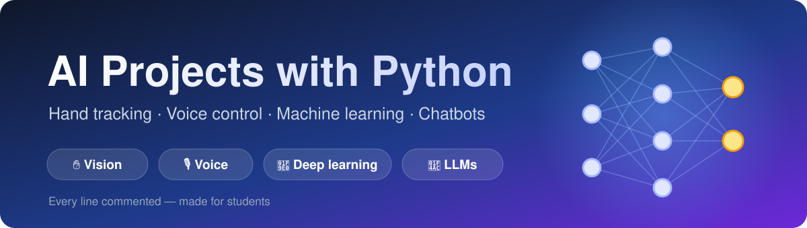
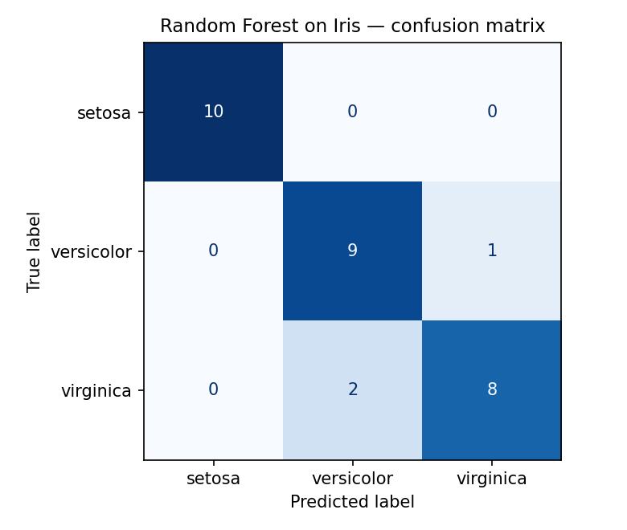
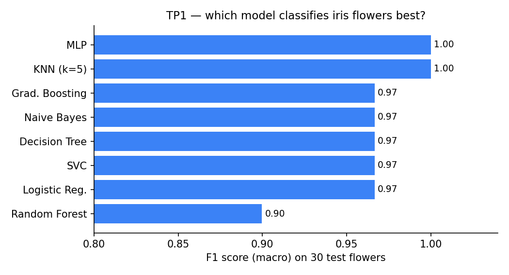

<div align="center">



**Hands-on artificial intelligence projects for students — computer vision, voice control, machine learning and chatbots.**

Every line of code is commented so you can read it like a lesson. 📖


</div>

---

## 📚 Table of contents

- [The projects](#-the-projects)
- [Suggested learning path](#-suggested-learning-path)
- [Installation](#%EF%B8%8F-installation)
- [Project details](#-project-details)
- [Folder structure](#-folder-structure)
- [Troubleshooting](#-troubleshooting)
- [Challenges for students](#-challenges-for-students)

---

## 🗂 The projects

| # | Project | Topic | What it does | Level |
|:-:|---|---|---|:-:|
| 1 | [`CapturePhoto.py`](CapturePhoto.py) | 📷 Webcam | Takes a photo and saves it on your Desktop | ⭐ |
| 2 | [`AI_Basic/SpeechRecognition.py`](AI_Basic/SpeechRecognition.py) | 🎙 Voice | Clicks the mouse when you say a command | ⭐ |
| 3 | [`AI_Basic/MediaPipeGeust.py`](AI_Basic/MediaPipeGeust.py) | ✋ Hand tracking | Swipe your finger to change slides | ⭐⭐ |
| 4 | [`AI_Basic/ControlPPTGesture.py`](AI_Basic/ControlPPTGesture.py) | ✋ Gestures | Thumb up / down & finger positions control a presentation | ⭐⭐ |
| 5 | [`AI_Basic/TeachableKerasWebcam.py`](AI_Basic/TeachableKerasWebcam.py) | 🧠 Deep learning | Recognises hand signs live with a Teachable Machine model | ⭐⭐ |
| 6 | [`AI_Basic/IMDBmoviePrediction.py`](AI_Basic/IMDBmoviePrediction.py) | 📊 Machine learning | Trains a neural network on IMDB movies to predict if you'll like one | ⭐⭐⭐ |
| 7 | [`AI_Basic/PPTcontrolGeustSpeech.py`](AI_Basic/PPTcontrolGeustSpeech.py) | ✋ + 🎙 | Finger moves the mouse, voice clicks | ⭐⭐⭐ |
| 8 | [`AI_Basic/MediaPipeSpeechUI.py`](AI_Basic/MediaPipeSpeechUI.py) | ✋ + 🎙 + 🖥 | Same, inside a desktop app (Tkinter) | ⭐⭐⭐ |
| 9 | [`CampusBot/`](CampusBot) | 💬 LLM chatbot | A local AI assistant (terminal + web app) | ⭐⭐⭐ |
| 10 | [`MLclassic/tp1_sklearn.py`](MLclassic/tp1_sklearn.py) | 🌸 Classic ML | Random Forest classifies iris flowers (scikit-learn) | ⭐ |

---

## 🧭 Suggested learning path

```
 📷 CapturePhoto ──► ✋ MediaPipeGeust ──► ✋ ControlPPTGesture ──► ✋🎙 PPTcontrolGeustSpeech ──► 🖥 MediaPipeSpeechUI
                                                                          ▲
 🎙 SpeechRecognition ────────────────────────────────────────────────────┘

 🌸 tp1_sklearn ──► 🧠 TeachableKerasWebcam ──► 📊 IMDBmoviePrediction ──► 💬 CampusBot
```

---

## ⚙️ Installation

### 1. Get the code

```bash
git clone https://github.com/Venki-Sub/AI-Python-Projects.git
cd AI-Python-Projects
```

### 2. Create a virtual environment

MediaPipe and TensorFlow sometimes disagree on library versions, so we use **two separate environments**.

**✋ Vision & voice projects** (1 – 4, 7, 8)

```bash
python3 -m venv mediapipe_env
source mediapipe_env/bin/activate        # Windows: mediapipe_env\Scripts\activate
brew install portaudio                   # macOS only: needed by PyAudio (microphone)
pip install -r requirements-vision.txt
```

**🧠 Machine learning projects** (5, 6, 10)

```bash
python3 -m venv ml_env
source ml_env/bin/activate               # Windows: ml_env\Scripts\activate
pip install -r requirements-ml.txt
```

**💬 CampusBot** (9)

```bash
cd CampusBot
python3 -m venv .venv
source .venv/bin/activate
pip install -r requirements.txt
# Install Ollama from https://ollama.com, then download the model:
ollama pull llama3.2:3b
```

### 3. Run a project

```bash
python CapturePhoto.py
```

> 💡 Projects in `AI_Basic/` are run the same way: `python AI_Basic/ControlPPTGesture.py`.
> They find the `Model/` folder by themselves, so you can also run them from inside `AI_Basic/`.

---

## 🔍 Project details

<details>
<summary><b>📷 1. CapturePhoto.py — your first webcam program</b></summary>

Opens the webcam, takes **one picture**, shows it and saves it as `captured_image.jpg` on your Desktop.

**You learn:** `cv2.VideoCapture`, `cap.read()`, `cv2.imshow`, `cv2.imwrite`.

</details>

<details>
<summary><b>🎙 2. AI_Basic/SpeechRecognition.py — control the mouse with your voice</b></summary>

Listens to the microphone and sends the audio to Google's free speech-to-text service.

| Say (French) | Action |
|---|---|
| `clic gauche` | Left click |
| `clic droit` | Right click |
| `double clic` | Double click |
| `arrêt` | Stop |

**You learn:** speech recognition, threads, error handling with `try / except`.
Needs an internet connection.

</details>

<details>
<summary><b>✋ 3. AI_Basic/MediaPipeGeust.py — swipe to change slides</b></summary>

MediaPipe finds the **21 key points** of your hand. We follow the tip of your index finger: if it moves more than 100 pixels left or right, the program presses the ← or → key.

Open a presentation, start the slideshow, then swipe! Press `q` to quit.

**You learn:** hand landmarks, normalised coordinates (0 → 1), measuring movement between frames.

</details>

<details>
<summary><b>✋ 4. AI_Basic/ControlPPTGesture.py — gesture remote control</b></summary>

| Gesture | Key | Action |
|---|---|---|
| Index finger left of thumb | → | Next slide |
| Index finger right of thumb | ← | Previous slide |
| 👍 Thumb up | F5 | Start slideshow |
| 👎 Thumb down | Esc | Exit slideshow |

**You learn:** comparing landmark positions to recognise a gesture.

The 21 hand landmarks found by MediaPipe. The code uses **4** (thumb tip), **8** (index tip), **3**, **9** and **12**:

<p align="center"></p>
<p align="center"><sub>Image: <a href="https://ai.google.dev/edge/mediapipe/solutions/vision/hand_landmarker">Google MediaPipe documentation</a>, licensed <a href="https://creativecommons.org/licenses/by/4.0/">CC BY 4.0</a>.</sub></p>

</details>

<details>
<summary><b>🧠 5. AI_Basic/TeachableKerasWebcam.py — your own image classifier</b></summary>

Uses a model trained on [Teachable Machine](https://teachablemachine.withgoogle.com) to recognise 4 hand signs: `Handsok`, `HandRight`, `HandLeft`, `HandUp`.

**Train your own:** create an *Image Project* on Teachable Machine → train → *Export model* → *TensorFlow* → *Keras* → replace `Model/keras_model.h5` and `Model/labels.txt`.

**You learn:** loading a Keras model, preprocessing images (resize, normalise), `argmax`.

</details>

<details>
<summary><b>📊 6. AI_Basic/IMDBmoviePrediction.py — a neural network on real data</b></summary>

Trains a neural network on `Model/imdb.csv` (thousands of movies) to predict if a movie is "liked" (rating > 7), then tests it on a random movie.

```
 CSV ─► clean data ─► train/test split ─► scale + one-hot encode ─► Dense(64) ─► Dense(32) ─► Dense(1, sigmoid) ─► 👍 / 👎
```

**You learn:** pandas, `train_test_split`, `StandardScaler`, `OneHotEncoder`, Keras `Sequential`, epochs and batches.

</details>

<details>
<summary><b>✋🎙 7. AI_Basic/PPTcontrolGeustSpeech.py — hands-free mouse</b></summary>

Your **index finger moves the mouse**, your **voice clicks** (same French commands as project 2). Runs without a window. Say `arrêt` to quit.

**You learn:** combining two AIs, running them in parallel with a thread, smoothing a shaky signal.

</details>

<details>
<summary><b>🖥 8. AI_Basic/MediaPipeSpeechUI.py — the desktop app version</b></summary>

Same as project 7, but inside a **Tkinter window** that shows the webcam and pop-ups when a voice command is detected.

**You learn:** building a GUI, `root.after()` to create a video loop without freezing the window.

</details>

<details>
<summary><b>💬 9. CampusBot — your own ChatGPT-style assistant</b></summary>

A chatbot for a school, running **100% on your computer** with [Ollama](https://ollama.com) and the Llama 3.2 model (no API key needed). It answers in French.

| File | How to run | What it is |
|---|---|---|
| `CampusBot/chat.py` | `python chat.py` | Chat in the terminal |
| `CampusBot/app.py` | `streamlit run app.py` | Chat web page with streaming answers |
| `CampusBot/web/` | `npm install && npm run dev` | Bonus: a full Next.js website with a chat widget (see `.env.example`) |

**How a chatbot remembers:**

```
 messages = [ system prompt ]
      │
      ├─► user asks      → append {"role": "user", ...}
      ├─► send ALL messages to the model
      └─► model answers  → append {"role": "assistant", ...}   ↺ repeat
```

</details>

<details>
<summary><b>🌸 10. MLclassic/tp1_sklearn.py — your first classic ML model</b></summary>

Classifies **iris flowers** into 3 species (setosa, versicolor, virginica) from 4 measurements of their petals and sepals, using a **Random Forest** (100 decision trees that vote).

```
 150 flowers ─► 80% train / 20% test ─► RandomForest(100 trees) ─► report + confusion matrix
```

Expected result: about **90% accuracy** on the 30 test flowers. A confusion-matrix window shows which species get mixed up:

<p align="center"></p>

The diagonal holds the correct answers. All 3 mistakes are between *versicolor* and *virginica*, whose petals have similar sizes.

**Try other models:** the file contains 7 other models, ready to uncomment. Here are their F1 scores on the same test flowers:

<p align="center"></p>

⚠️ With only 30 test flowers, one mistake changes the F1 by about 0.03, so don't over-trust the ranking. Change `random_state` and see how it moves!

**You learn:** `train_test_split` with `stratify`, `fit` / `predict`, precision, recall, f1-score, confusion matrix.

</details>

---

## 📁 Folder structure

```
AI-Python-Projects/
├── CapturePhoto.py
├── AI_Basic/
│   ├── SpeechRecognition.py
│   ├── MediaPipeGeust.py
│   ├── ControlPPTGesture.py
│   ├── PPTcontrolGeustSpeech.py
│   ├── MediaPipeSpeechUI.py
│   ├── TeachableKerasWebcam.py
│   └── IMDBmoviePrediction.py
├── Model/
│   ├── keras_model.h5        ← Teachable Machine model
│   ├── labels.txt            ← its 4 class names
│   └── imdb.csv              ← IMDB movie dataset
├── MLclassic/
│   └── tp1_sklearn.py        ← Random Forest on the Iris dataset
├── CampusBot/
│   ├── chat.py               ← terminal chatbot
│   ├── app.py                ← Streamlit web chatbot
│   └── web/                  ← Next.js website (bonus)
├── requirements-vision.txt
├── requirements-ml.txt
└── README.md
```

---

## 🛠 Troubleshooting

| Problem | Solution |
|---|---|
| `Could not open webcam` | macOS: *System Settings → Privacy & Security → Camera* → allow your Terminal / VS Code. Close other apps using the camera. |
| Mouse / keys don't move on macOS | *Privacy & Security → Accessibility* → allow your Terminal / VS Code. |
| `module 'mediapipe' has no attribute 'solutions'` | Install the pinned version: `pip install mediapipe==0.10.9` |
| `PyAudio` fails to install | macOS: `brew install portaudio` then `pip install pyaudio`. Windows: `pip install pipwin && pipwin install pyaudio` |
| Voice command not recognised | Speak clearly, check your internet, and check the microphone permission. |
| CampusBot: connection refused | Start the Ollama app and run `ollama pull llama3.2:3b`. |

---

## 🚀 Challenges for students

1. 📷 **CapturePhoto** — take 5 photos, one every second, with different file names.
2. 🎙 **SpeechRecognition** — switch to English (`language="en-US"`) and add a command that types text with `pyautogui.write()`.
3. ✋ **MediaPipeGeust** — add an up/down swipe that scrolls the page.
4. 👍 **ControlPPTGesture** — count how many fingers are raised and show the number on the video.
5. 🧠 **TeachableKerasWebcam** — train a model on your own objects (rock / paper / scissors?).
6. 📊 **IMDBmoviePrediction** — remove `rating` from the inputs. Does accuracy drop? Why?
7. 🖥 **MediaPipeSpeechUI** — the video colours look blue: can you find and fix the bug?
8. 🌸 **tp1_sklearn** — replace the Random Forest with `KNeighborsClassifier` or `DecisionTreeClassifier`. Which one scores best?
9. 💬 **CampusBot** — change the system prompt to create a bot for your own class or hobby.

---

<div align="center">

Made with ❤️ for students learning AI · ⭐ Star the repo if it helped you!

</div>
